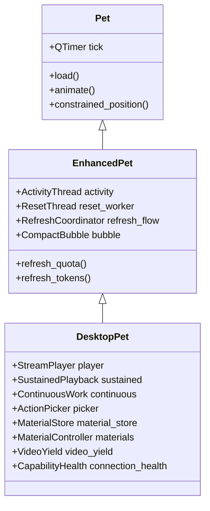

# Desktop-Pet 项目架构与实现解析报告

## 1. 项目概述与定位

`Desktop-Pet` 是一个基于 **Windows x64**、**Python 3.13** 与 **PySide6 (Qt for Python)** 构建的多角色 AI 桌面陪伴（桌宠）工程工作区。

项目的核心愿景是为三大主流 AI 助手提供对应的二次元桌面形象：
1. **ChatGPT 娘（白龙）**：已完全实现，原身是由独立项目 `Codex/` 演进而变身而来的完整生产级桌宠，深度集成 OpenAI Codex 的本地开发状态与额度用量。
2. **Claude 娘**：当前完成基础工程骨架搭建，已收录 4 段原始视频素材（平常、招手、日常、羞涩），等待资产透明化处理与平台适配器开发。
3. **Gemini 娘**：当前完成基础工程骨架搭建，已收录 6 段原始视频素材（打招呼、日常、惊鸿一瞥、喵喵喵、星星魔法、跳一跳），等待素材切分与平台适配。
4. **公共共享层（share/）**：从成熟的 ChatGPT 桌宠中抽离出的通用动画解码引擎与桌面系统级动效组件，供三大角色解耦复用。

---

## 2. 整体工程架构

### 2.1 目录分工与职责

```text
desktop-pet/
├── chatgpt/                     # 【成熟角色】ChatGPT (白龙) 桌宠
│   ├── app/                     # 业务界面、Codex 状态集成、数据服务与兼容层
│   ├── assets/character/        # 角色动画资源 (WebP/接缝动画) 及素材清单
│   ├── docs/                    # 角色架构设计 (ARCHITECTURE.md) 与开发说明 (DEVELOPMENT.md)
│   ├── tests/                   # 自动化回归测试 (250+ 测试用例) 与手动验收脚本
│   └── tools/                   # 构建、资源校验与优化工具链
├── claude/                      # 【待实现角色】Claude 娘工程骨架 + 原始 MP4
├── gemini/                      # 【待实现角色】Gemini 娘工程骨架 + 原始 MP4
├── share/                       # 【通用底层】跨角色共享模块
│   ├── pet_engine/              # 流式解码、持续动作、有界循环缓存、动作选择算法、打包封装
│   ├── desktop/                 # 弹簧曲线、Windows 高分屏原生坐标映射、非阻塞线程退出
│   └── requirements.txt         # 统一 Python 依赖清单
├── AI/                          # 规范化的 AI 产出与技术报告目录 (依 En-SKILL 规范)
└── En-SKILL.md                  # 本机工程规范与工具链约束说明
```

### 2.2 核心继承与启动依赖链路

以现有的 ChatGPT 桌宠为例，其启动层级与协作模式如下：



1. **`Pet`（基础层）**：负责无边框透明窗口属性配置（`FramelessWindowHint | WindowStaysOnTopHint | Tool`）、基础多屏位置约束、基础交互。
2. **`EnhancedPet`（状态服务层）**：整合后台监控工作线程，包含：
   - `ActivityThread`：监听本地 Codex 日志变化、IPC 状态及任务进度。
   - `ResetThread`：周期性刷新账户 5 小时重置倒计时与官方通知。
   - `CompactBubble`：悬浮状态胶囊/卡片与图表。
3. **`DesktopPet`（交互与动画中枢）**：装配 `StreamPlayer` 异步流式解码器、动作状态机 `SustainedPlayback`、弹簧物理抛掷动效、Windows 全屏避让以及托盘管理。

---

## 3. 核心技术亮点与子系统设计

### 3.1 自研高性能动画引擎 (`share/pet_engine`)

- **流式 6 帧异步队列 (`stream_player.py`)**：
  区别于传统桌宠将整段动画逐帧解压至内存或高频同步读取文件，引擎通过后台解码线程向 `queue.Queue(6)` 有界队列灌入 RGBA 帧，内存占用稳定在极小范围。
- **高精度无累积误差时钟**：
  针对 Windows 平台默认时钟粗粒度（~15.6ms）导致的帧率抖动问题，采用 `time.perf_counter()` 结合绝对时间戳累加推进播放头，消除了 41~42ms 动画源帧的舍入漂移。
- **持续动作状态机 (`sustained_player.py`)**：
  长循环动作（如持续敲代码、思考、发呆）采用五段式结构：
  $$\text{enter (入场)} \longrightarrow \text{seam (接缝)} \longleftrightarrow \text{body (循环主体)} \longrightarrow \text{exit (收尾)}$$
  通过预渲染的小片段过渡帧（接缝 seam）消除循环突变，并在循环体中施加微调正弦速度变化（$0.94\sim1.04\times$），使角色呼吸更显自然；且在准备退出时预先在后台拉起 `PreparedSegment` 预热收尾帧，实现主线程无缝切出。
- **有界无损缓存 (`loop_cache.py`)**：
  对高频循环段采用 zlib 压缩/解压暂存，大幅节省 CPU 解码开销。

### 3.2 Codex 运行状态实时联动 (`chatgpt/app/`)

- **会话与任务感知**：
  通过 `ActivityThread` 和 `RolloutTail` 深度解析本机 Codex 运行日志，将 AI 行为映射为桌宠状态：
  - `working`：角色进入工作状态（敲代码/思考）。
  - `waiting`：需要用户交互或确认，桌宠给出提示。
  - `compacting`：上下文压缩中。
  - `done`：任务完成，记录至未读提醒账本（`completion_ledger.py`）。
- **Token 统计与日报可视化**：
  - 内置基于 SQLite 的 `TokenUsageIndex`，自动聚合本地日志中的输入/输出 Token 消耗。
  - 在卡片内提供日历热力图（Calendar Heatmap）、分段用量曲线（`token_charts.py`）以及每日统计报告（`daily_report.py`）。
- **额度追踪与重置监测**：
  - 解析本机 Codex 的当前可用额度及 Rate Limit 重置时间（`quota.py`）。

### 3.3 桌面体验与物理交互 (`share/desktop`)

- **物理拖拽与弹簧抛掷**：
  记录拖动指针样本队列计算即时速度矢量，释放时触发基于二阶阻尼弹簧曲线的惯性滑动与边界碰撞回弹（`spring_motion.py`）。
- **全屏智能避让 (`video_yield.py`)**：
  自动监测 Windows 当前活跃窗口是否处于全屏视频/游戏播放状态；全屏时主动取消置顶避免遮挡观影，但在有高优先级未读任务通知时可穿透提醒。
- **单实例与守护集成**：
  通过 `QLocalServer`/`QLocalSocket` 确保单实例运行，重复启动自动唤醒置顶；支持开机自启和伴随 Codex 进程自启。

### 3.4 资产构建与单文件分发体系 (`chatgpt/tools/`)

- **轻量/高清双画质架构**：
  - 源码与轻量模式使用 WebP 动画（仓库内约 590MB），确保克隆后即开即用。
  - 高清模式支持原尺寸高质量贴图。
- **PyInstaller 单文件专属优化**：
  - 传统 PyInstaller 打包会将大素材全部打包进 `_MEIPASS` 临时目录，启动时耗时数十秒解压。
  - 该项目采用特殊的内嵌资源区设计（`embedded_assets.py`），素材位于 exe 尾部内嵌段，首次运行或切换画质时仅做一次 SHA-256 校验并解压至 `%LOCALAPPDATA%\BailongEnhanced\materials`，后续通过文件特征秒级校验直接加载。

---

## 4. 后续规划（Claude 与 Gemini）

| 步骤 | 内容 | 关键产出 |
| :--- | :--- | :--- |
| **阶段 1：素材处理** | 将 Claude (4段) 和 Gemini (6段) 原始 MP4 转为透明背景 WebP 帧序列 | 提炼入场、循环体、循环接缝和收尾，生成 `素材清单.json` |
| **阶段 2：角色入口搭建** | 复用 `share/pet_engine` 和 `share/desktop`，构建独立的 `app/` 启动入口 | 独立窗口、基础拖拽与动作轮播 |
| **阶段 3：平台适配器** | 分别实现 Claude 与 Gemini 的本地数据适配器（映射对话状态与用量） | 隔离数据存储目录（不与 BailongEnhanced 混用） |
| **阶段 4：测试与构建集成** | 编写单元回归测试与独立 PyInstaller 构建入口 | 纳入 `tools/check.py` 自动化检测矩阵 |

